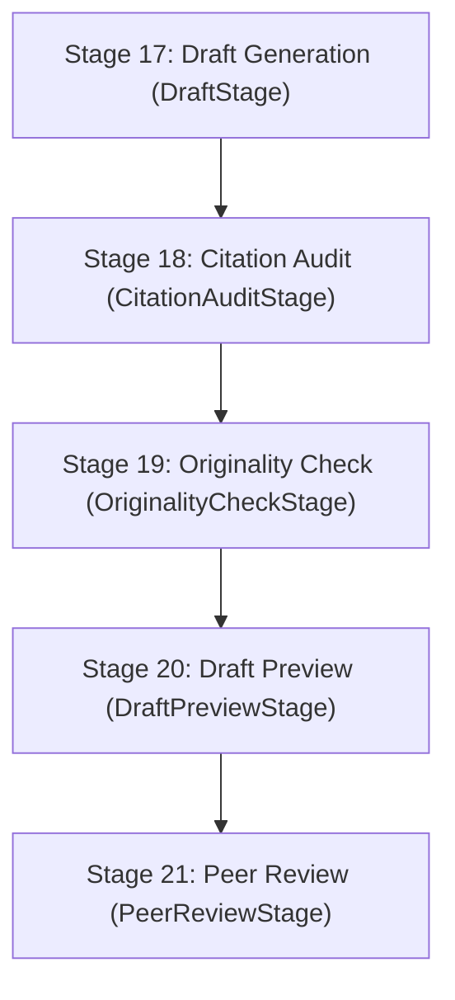

# 34. Drafting & Preview Pipeline Architecture

This document details the architectural specifications, lifecycle contracts, and streaming protocols governing **Stage 17 (Draft Generation)** through **Stage 20 (Draft Preview)** in Scholar Core's 25-stage journal pipeline.

---

## 1. Stage Overview & Cognitive Flow



1. **Stage 17 — Draft Generation (`/api/projects/:id/agent/draft`)**:
   - Synthesizes empirical evidence, vault sources, and journal requirements into structured manuscript sections (`Introduction`, `Methodology`, `Results`, `Discussion`, `Conclusion`).
   - Dual-persistence contract: writes to Supabase `manuscript_sections` (when available) AND synchronously saves the canonical JSON sections string into `project.answers.manuscript_draft` via `projectStore.save()`.

2. **Stage 18 — Citation Audit (`/api/projects/:id/agent/citation-audit`)**:
   - Verifies citation provenance against extracted vault items and evidence tokens (`[ev-xxxx]`).

3. **Stage 19 — Originality Check (`/api/projects/:id/agent/originality-check`)**:
   - Evaluates syntactic and semantic uniqueness against academic norms.

4. **Stage 20 — Draft Preview (`/api/projects/:id/agent/draft-preview`)**:
   - Assembles the generated sections into a camera-ready formatted manuscript.
   - Computes page approximations (~250 words per page).
   - Generates dynamic navigation anchors based on detected `## Section` markdown headers.

---

## 2. Server-Sent Events (SSE) Protocol Contract

All agentic pipeline endpoints strictly implement the SSE protocol:
```http
POST /api/projects/:id/agent/draft-preview
Content-Type: application/json

HTTP/1.1 200 OK
Content-Type: text/event-stream
Cache-Control: no-cache
Connection: keep-alive

event: log
data: {"message": "Assembling manuscript sections..."}

event: log
data: {"message": "Rendering preview (8 pages)..."}

event: done
data: {"ok": true, "data": {"content": "## Abstract\n\n...", "pages": 8, "status": "Ready"}}
```

### Resilient Data Resolution Hierarchy
To ensure zero failure when cloud storage or Supabase connectivity fluctuates, `/draft-preview` executes a two-tier resolution strategy:
1. **Tier 1 (Supabase Relational)**: Queries `manuscript_sections` ordered by section position if `getSupabaseRestConfig()` is active.
2. **Tier 2 (ProjectStore Answers Fallback)**: If Supabase returns empty or errors, falls back to `project.answers.manuscript_draft` or `project.answers.assembled_draft`.
3. **Empty State**: If neither source contains generated text, emits a clear non-fatal status: `"Draft not generated yet. Please navigate to Stage 17 (Drafting) to generate your first draft."`

---

## 3. Frontend Stage Timer Lifecycle Architecture

Synthetic terminal logs (`AgentTerminal`) provide immediate visual feedback during LLM generation. To prevent infinite interval loops:

1. **`useRef` Storage**: Timers are stored in React references (`logIntervalRef = useRef<ReturnType<typeof setInterval> | null>(null)`), decoupling timer state from render lifecycles.
2. **Deterministic Clearing**: `clearTimer()` is called unconditionally:
   - Immediately before spawning a new agent run.
   - Upon receiving `event === "done"`.
   - Upon receiving `event === "error"`.
   - In the `catch (err)` block.
   - In the `finally` block.
3. **Unmount Cleanup**: Every stage mounts an unmount effect:
   ```typescript
   useEffect(() => {
     return () => {
       clearTimer();
     };
   }, []);
   ```
4. **Immediate State Hydration**: Stages hydrate their initial preview state from `project.answers` on mount, eliminating unnecessary re-generation when navigating back to completed stages.
