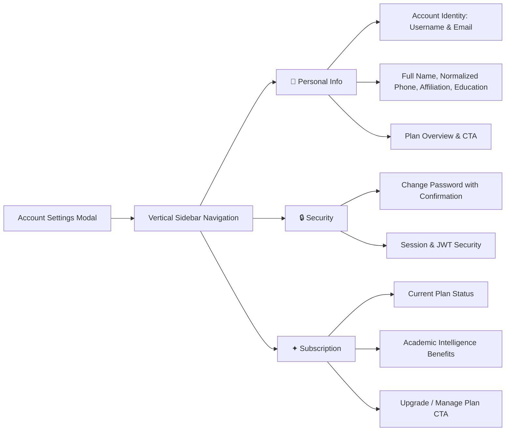
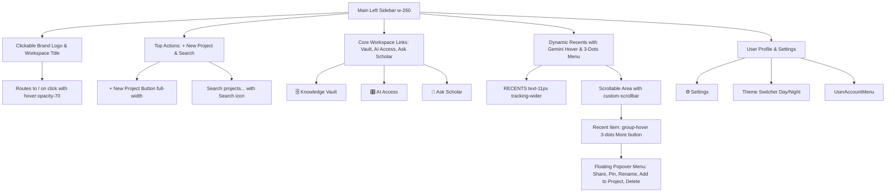

# Account Settings, Multi-User & Navigation Specification

## Overview

The Account Settings and User Navigation architecture in Scholar Core is designed for high-density academic usability, scannability, and minimal cognitive friction inspired by design systems from **Airbnb, ChatGPT, and Gemini**.

---

## 1. Information Deduplication Architecture ("Declare It Once")

In dense multi-agent academic tools, repeated UI elements and redundant status banners dilute focus. Scholar Core strictly enforces the **Declare It Once** standard:

| UI Area | Redundancy Eliminated | Modernized Experience |
| :--- | :--- | :--- |
| **Sidebar User Card & Popover** | Dropdown previously rendered a bulky `"Signed in as [Name] [Email]"` card repeating the trigger card. | Popover menu drops redundant user repetition and renders clean, categorized action groups (`Settings`, `Help`, `Switch Accounts`, `Sign Out`). |
| **Multi-Account Redundancy** | Multi-account management was previously duplicated across both the profile popover and a dedicated settings tab. | **Consolidated exclusively into `UserAccountMenu.tsx`**: Adding, switching, removing accounts, and signing out live strictly in the popover. The redundant "Users & Accounts" tab in `AccountSettingsScreen.tsx` has been eliminated. |
| **Settings Taxonomy** | Dropdown menu button and navigation paths were inconsistent. | The menu button simply says **"Settings"** and opens directly to the **Personal Info** tab (`initialTab="personal"`), providing an immediate, predictable mental model. |
| **Username vs Email** | For single-sign-on or email accounts where username defaults to email, two stacked read-only inputs appeared. | Rendered in a unified 2-column "Account Identity" container with clear `Read-only` badges and monospace font. |
| **Dial Code & E.164 Cleansing** | Pre-filled phone numbers storing country codes (e.g. `+977` + `+9779821849301`) caused E.164 validation failure. | Automated cleansing via `stripDialCode(dialCode, phone)` ensures phone numbers are always normalized to local numbers with dial code prefix applied cleanly once. |
| **Section Headings & Legacy Text** | Tab titles were repetitively echoed with negative framing ("not related to AI configuration"). | Replaced with clean, helpful context headers emphasizing academic identity and credential security. |

---

## 2. Strategic Pricing & Purchasing Repetition

Per design system guidelines, while general interface elements follow the strict "Declare It Once" rule, **pricing and purchasing information is strategically repeated for user visibility and conversion**:
- **Overview Card in Personal Info**: Shows the current active plan (`Scholar Free` vs `Scholar Premium`) and immediate `Upgrade to Premium` CTA.
- **Dedicated Subscription Tab**: Detailed feature matrix highlighting multi-model academic intelligence (Claude 3.7, GPT-4o, Gemini 2.5), Knowledge Vault encrypted cloud drive sync, and priority background compute.

---

## 3. Account Settings Navigation Structure (3-Tab Model)

`AccountSettingsScreen` employs a streamlined 3-tab vertical navigation pattern:



---

## 4. Multi-Account Switching & Session Registry (Exclusively in UserAccountMenu)

The multi-account architecture (`src/services/auth/multiAccountService.ts`) enables researchers with multiple affiliations (e.g. personal research, university `.edu`, institutional laboratory) to seamlessly toggle accounts without full sign-outs. Following the "Declare It Once" standard, this functionality lives **exclusively within `UserAccountMenu.tsx`**:
- **Local Multi-Account Store**: Cached in `scholar_multi_accounts_registry_v1`.
- **Instant Profile Switcher**: `switchActiveAccount(userId)` swaps active session tokens with zero data loss.
- **Embedded Secondary Auth**: Researchers can link secondary accounts through `EmbeddedAuthModal` directly from the popover without modal nesting or settings clutter.

---

## 5. Sticky Footer & Viewport Resilience

To ensure maximum usability across diverse screen resolutions (including 13-inch and 14-inch laptops like MacBook Air), `AccountSettingsScreen` adopts a **pinned sticky footer pattern**:
- **Always-Visible Save Action**: The `Save changes` button and live status indicators (`Saved.`, error messages) are pinned in a dedicated footer bar (`flex-shrink-0 border-t border-[color:var(--border-subtle)]`).
- **No Below-the-Fold Clipping**: Form inputs scroll independently inside `overflow-y-auto`, ensuring primary save actions and status messages are never clipped below the fold.
- **Enter-to-Submit**: The profile form is wrapped in a `<form id="account-profile-form">` with `onSubmit` wired to `handleSaveProfile()`, allowing instant keyboard submission from any input.
- **Service Worker Cache Busting**: Service worker cache updated to `scholar-os-v3` to ensure instant asset invalidation across client browsers.

---

## 6. Top Navigation & "Ask Scholar" Assistant Drawer Specification

The top utility navigation across the dashboard (`ProjectListScreen.tsx` and `ScholarAgenticDashboard.tsx`) provides seamless access to the right-hand **Ask Scholar** assistant drawer:

- **Humanized Brand & UX Copy**:
  - **Header**: "Ask Scholar" (replacing legacy "Scholar Core Assistant").
  - **Subtitle / Greeting**: "How can I help you with your research today?" (replacing technical "Platform navigation, workflows & AI setup").
  - **Input Prompt**: "Ask anything, search projects, or type a command..." (expanded multi-modal search and agentic command capability).
  - **Bottom Status**: "Ask Scholar" paired with green `• AI Ready` indicator.
- **Lightbulb Icon Integration**: Features a clean, minimalist `Lightbulb` icon from `lucide-react` styled within a circular container (`w-10 h-10 rounded-full`, subtle border, responsive amber/neutral hover effects).
- **Zero Tooltips / Decluttering**: All `title` attributes and hover tooltips (such as "Advisor Center" or "Open Scholar Assistant") are completely removed to maintain a serene, distraction-free reading atmosphere.
- **Conditional Visibility ("Hide on Open")**:
  - The toggle button is conditionally wrapped in `{!isAiSidebarOpen && ( <button ... /> )}` / `{!isSidebarOpen && ( <button ... /> )}`.
  - When the assistant sidebar is closed, the button is clearly visible in the top-right header.
  - When clicked, the right sidebar smoothly slides out, and the toggle button **completely unmounts from the top navigation** to eliminate visual clutter.
  - Clicking the `X` button (`aria-label="Close Assistant"`) in the drawer header closes the sidebar and restores the toggle button in the top navigation.

---

## 7. Left Sidebar Navigation Specification (ChatGPT / Gemini Style)

The primary left sidebar navigation (`ProjectListScreen.tsx`) mirrors the dynamic, focused user experience of modern AI interfaces (ChatGPT and Gemini):



- **Clickable Header Logo**:
  - The "Scholar Core" brand icon and text in the sidebar and top navigation bars are wrapped in a link (`<Link to="/">`) or interactive container with `cursor-pointer transition-opacity duration-200 hover:opacity-70`, routing users smoothly to `/` (home dashboard).
- **Top Actions**:
  - Preserves the prominent full-width `+ New Project` button at the top.
  - Sits an integrated real-time search field immediately below: `<div className="relative mb-4"><Search ... /><input type="text" placeholder="Search projects..." ... /></div>`.
  - Tied directly to `searchQuery` state, filtering both the main workspace and recent projects.
- **Core Workspace Links (The Library)**:
  - Redundant top "Projects" folder button removed to avoid duplicate navigation controls with the main canvas.
  - High-fidelity links for `Knowledge Vault`, `AI Access`, and `Ask Scholar` with `lucide-react` icons and Airbnb-inspired `text-[13px] font-medium antialiased`.
  - "Ask Scholar" link directly triggers the slide-out AI assistant drawer.
- **Recents Scrollable Area & Gemini-Style 3-Dots Popover**:
  - Section header styled to `text-[11px] font-semibold text-gray-500 dark:text-gray-400 uppercase tracking-wider mb-2 px-3 mt-5`.
  - List items wrapped in `group flex items-center justify-between px-3 py-2 rounded-lg hover:bg-gray-100 dark:hover:bg-[#202124] transition-colors cursor-pointer text-[13px] font-medium text-gray-700 dark:text-gray-200 antialiased`.
  - Item title text truncated cleanly: `<span className="truncate pr-2">{item.title}</span>`.
  - More button with `MoreVertical` icon is hidden by default and revealed on hover (`opacity-0 group-hover:opacity-100 transition-opacity p-1 rounded-md hover:bg-gray-200 dark:hover:bg-[#303134] text-gray-500`).
  - Floating popover menu (`absolute z-50 shadow-xl rounded-xl bg-white dark:bg-[#1e1e1e] border border-gray-100 dark:border-neutral-800 p-1 min-w-[180px]`) featuring:
    1. **Share** (`Share2`): Copies project link to clipboard.
    2. **Pin** (`Pin`): Toggles pinned status for quick access.
    3. **Rename** (`Pencil`): Prompts user and syncs new title to project intake.
    4. **Add to Project** (`FolderPlus`): Navigates directly into the target project workspace.
    5. **Delete** (`Trash2`): Prompts project deletion confirmation modal with styled red accents (`text-red-500 dark:text-red-400`).
  - Outside-click and Escape key event listeners automatically close the popover.
  - Dynamically flips upwards (`bottom-full mb-1`) when near the bottom boundary of the scroll view to prevent viewport clipping.
- **Persistent Shell Architecture**:
  - Root dashboard layout strictly follows a fixed shell layout:
    ```tsx
    <div className="flex h-screen w-full overflow-hidden bg-slate-50">
      <LeftSidebar />
      <main className="flex-1 overflow-y-auto relative">
        {/* Dynamic Central Content (Projects, Knowledge Vault, AI Access) */}
      </main>
      {isSidebarOpen && <RightAssistantSidebar />}
    </div>
    ```
  - Both `<LeftSidebar />` and `<RightAssistantSidebar />` remain permanently mounted in the DOM while the user switches between core views (`Projects`, `Knowledge Vault`, `AI Access`).
- **Bidirectional "Ask Scholar" Sidebar Toggle**:
  - The "Ask Scholar" button in the left sidebar toggles the assistant sidebar state open and closed: `onClick={() => setIsSidebarOpen(prev => !prev)}` / `onClick={() => setIsAiSidebarOpen(prev => !prev)}`.
  - The top bar Lightbulb button conditionally renders only when the assistant sidebar is closed, providing a seamless open toggle.
- **Seamless Central Routing**:
  - View switching strictly utilizes React Router (`<Link>`, `navigate`) or local state (`setActiveView(...)`), eliminating full HTML page reloads and avoiding native `<a href="...">` anchors.

---

## 8. Verification & Testing

All components and workflows are covered by comprehensive unit tests:
- `AccountSettingsScreen.test.tsx`: 22 tests covering identity immutability, dial-code sanitization, tab switching, password validation, and sticky save actions.
- `UserAccountMenu.test.tsx`: 5 tests validating profile display, menu options, consolidated multi-account actions, and pricing absence in the minimal dropdown.
- `ProjectListScreen.test.tsx`: 26 tests verifying persistent sidebar layout, responsive navigation, top actions with search, recents list rendering with Gemini-style 3-dots popover options, footer settings integration, and the bidirectional Scholar Core Assistant toggle lifecycle.
- `DeskApp.test.tsx`: 14 tests validating persistent shell routing across `/projects`, `/settings`, `/vault`, and `/ai-access`.
- Full test pass: 2,571/2,571 tests across all 236 test files passing, TypeScript compilation clean (`tsc --noEmit` exit 0), and production build passing (`npm run build`).


