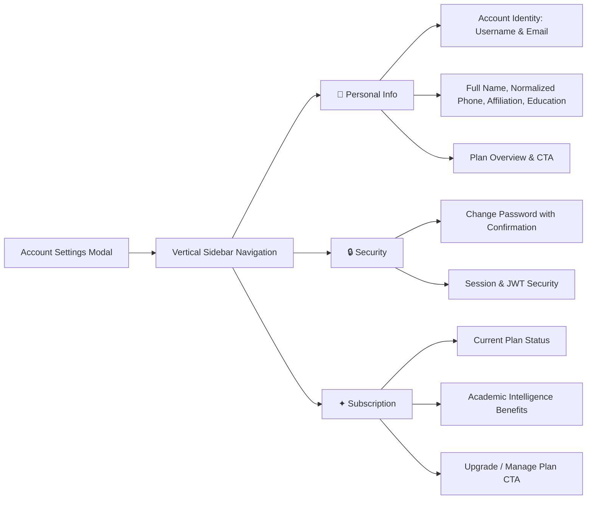

# Account Settings, Multi-User & Navigation Specification

## Overview

The Account Settings and User Navigation architecture in Scholar Core is designed for high-density academic usability, scannability, and minimal cognitive friction inspired by design systems from **Airbnb, ChatGPT, and Gemini**.

---

## 1. Information Deduplication Architecture ("Declare It Once")

In dense multi-agent academic tools, repeated UI elements and redundant status banners dilute focus. Scholar Core strictly enforces the **Declare It Once** standard:

| UI Area | Redundancy Eliminated | Modernized Experience |
| :--- | :--- | :--- |
| **Sidebar User Card & Popover** | Dropdown previously rendered a bulky `"Signed in as [Name] [Email]"` card repeating the trigger card. | Popover menu drops redundant user repetition and renders clean, categorized action groups (`Settings`, `Help`, `Switch Accounts`, `Sign Out`). |
| **Multi-Account Redundancy** | Multi-account management was previously duplicated across both the profile popover and a dedicated settings tab. | **Consolidated exclusively into `UserAccountMenu.tsx`**: Adding, switching, removing accounts, and signing out live strictly in the popover. The redundant "Users & Accounts" tab in `AccountSettingsScreen.tsx` has been eliminated. |
| **Settings Taxonomy** | Dropdown menu button and navigation paths were inconsistent. | The menu button simply says **"Settings"** and opens directly to the **Personal Info** tab (`initialTab="personal"`), providing an immediate, predictable mental model. |
| **Username vs Email** | For single-sign-on or email accounts where username defaults to email, two stacked read-only inputs appeared. | Rendered in a unified 2-column "Account Identity" container with clear `Read-only` badges and monospace font. |
| **Dial Code & E.164 Cleansing** | Pre-filled phone numbers storing country codes (e.g. `+977` + `+9779821849301`) caused E.164 validation failure. | Automated cleansing via `stripDialCode(dialCode, phone)` ensures phone numbers are always normalized to local numbers with dial code prefix applied cleanly once. |
| **Section Headings & Legacy Text** | Tab titles were repetitively echoed with negative framing ("not related to AI configuration"). | Replaced with clean, helpful context headers emphasizing academic identity and credential security. |

---

## 2. Strategic Pricing & Purchasing Repetition

Per design system guidelines, while general interface elements follow the strict "Declare It Once" rule, **pricing and purchasing information is strategically repeated for user visibility and conversion**:
- **Overview Card in Personal Info**: Shows the current active plan (`Scholar Free` vs `Scholar Premium`) and immediate `Upgrade to Premium` CTA.
- **Dedicated Subscription Tab**: Detailed feature matrix highlighting multi-model academic intelligence (Claude 3.7, GPT-4o, Gemini 2.5), Knowledge Vault encrypted cloud drive sync, and priority background compute.

---

## 3. Account Settings Navigation Structure (3-Tab Model)

`AccountSettingsScreen` employs a streamlined 3-tab vertical navigation pattern:

---

## 4. Multi-Account Switching & Session Registry (Exclusively in UserAccountMenu)

The multi-account architecture (`src/services/auth/multiAccountService.ts`) enables researchers with multiple affiliations (e.g. personal research, university `.edu`, institutional laboratory) to seamlessly toggle accounts without full sign-outs. Following the "Declare It Once" standard, this functionality lives **exclusively within `UserAccountMenu.tsx`**:
- **Local Multi-Account Store**: Cached in `scholar_multi_accounts_registry_v1`.
- **Instant Profile Switcher**: `switchActiveAccount(userId)` swaps active session tokens with zero data loss.
- **Embedded Secondary Auth**: Researchers can link secondary accounts through `EmbeddedAuthModal` directly from the popover without modal nesting or settings clutter.

---

## 5. Verification & Testing

All components and workflows are covered by comprehensive unit tests:
- `AccountSettingsScreen.test.tsx`: 21 tests covering identity immutability, dial-code sanitization, tab switching, and password validation.
- `UserAccountMenu.test.tsx`: 4 tests validating profile display, menu options, and pricing absence in the minimal dropdown.
- `ProjectListScreen.test.tsx`: 15 tests verifying sidebar layout, responsive navigation, and footer settings integration.
