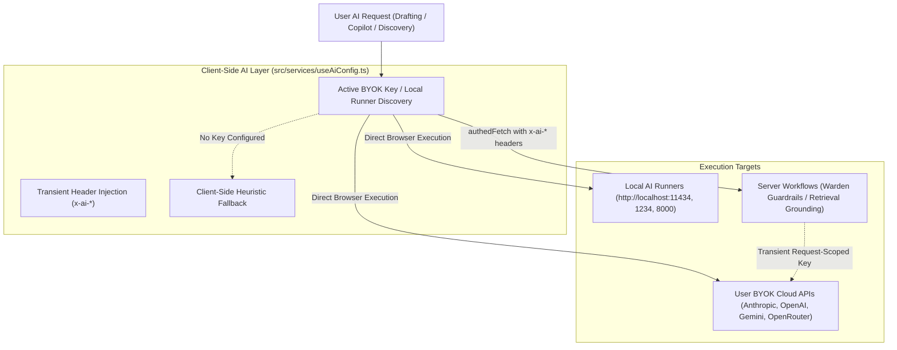
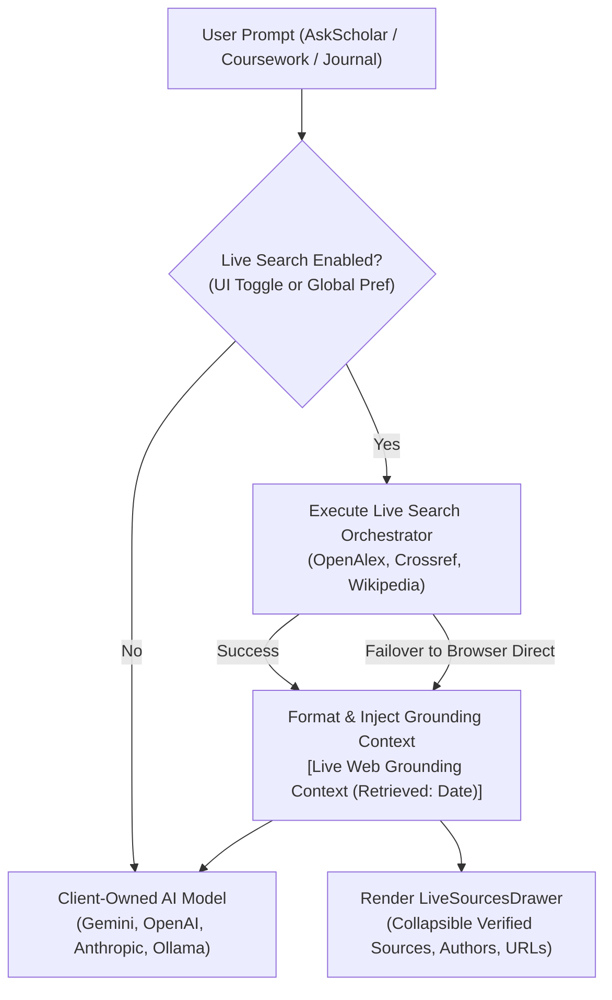

# AI Architecture & Routing System

This document specifies the current AI gateway, candidate resolution routing, multi-provider failover engine, local model runners, prompt engineering system, and error recovery policies in **Scholar Core**.

---

## 0. The AI router (server, since #140–#144)

Every server-side AI call goes through one router: `src/platform/router/`, bridged by `server/src/ai/routerBridge.ts`. Sections 3, 4 and 9 below describe the client-side gateway (`src/platform/gateway/`), which is now used only for browser-side runs: local models, and the Ask Scholar retry when the server cannot answer.

- **Chain per request.** Premium resources (entitled, within quota; `server/src/ai/premiumPort.ts`), then the user's own keys in their order, then their local model.
  - Keys arrive per request in the `x-ai-keyring` header (base64url JSON, at most 8 entries).
  - The legacy `x-ai-*` headers are read as the user's primary entry.
  - Keys are used for that request only: never stored, logged or returned.
- **Visible failover** (`router.ts`). Every switch, retry, skip and limit is an event with its reason.
  - Partial output is never silently retried.
  - First-token timeout 25 s, idle timeout 20 s.
  - Retry-After is honoured; a wait over 20 s switches to the next candidate instead.
  - A circuit breaker (`circuitBreaker.ts`) skips a failing provider for a while.
- **Preflight** (`tokenBudget.ts`). The prompt is estimated against the model's context; the answer is clamped with a `limit_warning` event, or the candidate is skipped.
- **Where events go.**
  - JSON AI responses carry `aiRoute { answeredBy, notices, usage }` (`aiRouteDecorator`), and the client shows notices as a toast (`src/desk/ai/aiRouteNotices.ts`).
  - Streams forward every event as `route` SSE events, and `authedStreamFetch` feeds them to the workspace status dock (`src/desk/ai/LiveAiStatusDock.tsx`), whose Stop aborts the request.
  - `POST /api/ai/run` is the direct SSE endpoint (`server/routes/aiRun.ts`).
- **Local models.** They run on the server only where `serverCanReachLocalModels()` allows it (development, or `ALLOW_SERVER_LOCAL_AI=true`). Elsewhere the request is handed to the browser (426 with a signed challenge).
- **User-named endpoints** (`server/src/ai/aiEndpointGuard.ts`).
  - Apart from the providers' own API hosts, an endpoint must use https and resolve only to public addresses, and the connection is pinned to the checked addresses.
  - A blocked endpoint is skipped with its reason.
  - `ALLOW_PRIVATE_AI_ENDPOINTS=true` lifts this check for self-hosted installs.
- **Models** (`GET /api/ai/models`, `modelListers.ts`, `modelCuration.ts`).
  - The list is each provider's live model list, curated by rules: text models only, stable aliases over dated snapshots, no stale previews, newest generation per family and tier, at most 4 per provider.
  - Badges appear only with evidence: provider tier, reported context size, measured speed (20 or more samples), or a pinned benchmark with its source.

## 1. AI System Overview

Scholar Core enforces a **Strict Client-Owned BYOK / Local AI Architecture**. The platform does NOT provide server-owned, platform-paid, or free-tier server AI quotas. All AI inference executes strictly using the user's own credentials (BYOK API keys stored client-side in encrypted IndexedDB / local device storage, or Local AI runners on `http://localhost:*` such as Ollama, LM Studio, vLLM, and LocalAI).



---

## 2. Operational AI Modes & Architecture Principles

Users configure their AI connection in `/ai-access`:

1. **Bring Your Own Key (BYOK)**:
   - Users supply their personal API keys stored exclusively on their device.
   - Transient request-scoped headers (`x-ai-provider`, `x-ai-api-key`, `x-ai-model`, `x-ai-base-url`) are attached client-side for orchestrating server workflow calls.
   - Keys are **never** persisted in PostgreSQL/Supabase and are scrubbed/redacted from all server logs.
   - Live dynamic model discovery queries provider `/models` endpoints with zero hardcoded model lock-in.
2. **Local AI (Zero Egress)**:
   - Routes inference directly to locally running engines on the user's machine (Ollama, LM Studio, vLLM, LocalAI) on loopback ports (`127.0.0.1:11434`, `127.0.0.1:1234`, `127.0.0.1:8000`).
   - Private Network Access (PNA) and CORS guidance are handled transparently.
   - Complete privacy guarantee for sensitive institutional research.
3. **Offline Heuristic Mode**:
   - Hard network egress lock when no credentials are configured.
   - Employs deterministic academic heuristic synthesizers, rule-based audits, and offline templates.
   - The workspace header presents: `"Offline Heuristic Mode — Connect API Key in AI Access"` with a direct 1-click link to configuration.

---

## 3. Client-Side Candidate Resolution (`clientRouter.ts`)

Candidate selection resolves at request time on the client:

1. **Task Categorization**:
   - Requests are tagged by capability requirement: `drafting` (high reasoning, long context), `copilot` (low latency, conversational), `discovery` (high search precision), `audit` (rule compliance and structural extraction).
2. **Preference Evaluation**:
   - Checks user preferences saved in `localStorage` / user profile. If a user has pinned a specific provider or model for that task, it is placed at the top of the candidate list.
3. **Hardware Profiling (`hardwareProfiler.ts`)**:
   - If Local AI is active, the system queries local device RAM, GPU availability, and model parameters to ensure the model will not trigger an out-of-memory error.
4. **Candidate Queue Assembly**:
   - Constructs an ordered priority queue of `(Provider, Model)` tuples to execute in sequence if failures occur.

---

## 4. Multi-Provider Failover Engine (`providerFailover.ts`)

The failover engine wraps all AI calls to guarantee high availability during upstream provider incidents:

- **Trigger Conditions**:
  - HTTP `429 Too Many Requests` (Rate limit or quota exhausted).
  - HTTP `500`, `502`, `503`, `504` (Provider server outage).
  - Network timeouts (configurable per task, default 30s).
- **Quarantine Policy**:
  - When a provider fails with 429 or 5xx, it is placed into quarantine with exponential backoff (starting at 60s, doubling up to 15 minutes).
  - While quarantined, subsequent requests automatically bypass this provider and route to the next candidate in the queue.
- **Failover Event Stream**:
  - The client UI emits non-blocking toast notifications when a failover occurs (e.g. *"Primary provider rate-limited. Seamlessly switched to secondary model"*), maintaining transparency without interrupting the user's workflow.

---

## 5. Local Runner Integration (`localRunnerCatalog.ts`)

Scholar Core automatically probes standard local runner ports on application startup:

| Runner | Default Host | Discovery Endpoint |
| :--- | :--- | :--- |
| **Ollama** | `http://localhost:11434` | `GET /api/tags` |
| **LM Studio** | `http://localhost:1234` | `GET /v1/models` |
| **vLLM** | `http://localhost:8000` | `GET /v1/models` |
| **LocalAI** | `http://localhost:8080` | `GET /v1/models` |

When a local runner is detected:
- The `/ai-access` interface displays green connectivity status.
- Available locally installed models (e.g. `llama3.3:latest`, `deepseek-r1:14b`, `mistral:latest`) are automatically populated into model selection dropdowns.

---

## 6. Prompt Engineering Architecture

Prompts in Scholar Core are strictly structured around academic requirements:

### 6.1 Phase Copilot Personas (`ContextPanel.tsx`)
- **Phase 1 · Advisor**: System prompt enforces structural decomposition, research question formulation, command verb unpacking, and academic level calibration.
- **Phase 2 · Librarian**: System prompt enforces bibliographic rigor, publication venue credibility, empirical relevance filtering, and evidence gap detection.
- **Phase 3 · Scribe**: System prompt enforces PEEL paragraph structure (Point, Evidence, Explanation, Link), target word budgets, and registered voice constraints.
- **Phase 4 · Examiner**: System prompt enforces objective rubric scoring, critical critique, and strict citation reconciliation.

### 6.2 Analytical Outline Generation (`outlineService.ts`)
- System prompt instructs the model to analyze the specific prompt, thesis, and discipline.
- Strictly forbids generic template outputs ("Introduction", "Body Paragraph 1", "Conclusion").
- Requires dynamic analytical headings reflecting the substantive arguments, variables, and case studies of the prompt.
- Enforces JSON output matching the `AssignmentStructure` schema.

### 6.3 Section Drafting Prompt (`server/routes/project/assignment.ts`)
- Contextual inputs:
  - Full Assignment Brief (Topic, Academic Level, Citation Style).
  - Selected Writing Style & Tone (e.g. *Analytical*, *Argumentative*, *Critical*, or syntax patterns extracted from user's custom essay).
  - Active Subheading Name and Author Guidance Notes.
  - Target Word Budget for this specific section.
  - Approved Evidence Items mapped to this section (including quotes and authors).
- Output constraints:
  - Generates cohesive academic prose with embedded in-text citations matching approved evidence.
  - Adheres strictly to the target word budget.

### 6.4 Adversarial Peer Review Simulator (`server/routes/project/agentic.ts`)
- Runs 5 concurrent specialized referee evaluations against the drafted manuscript:
  1. *Methodologist*: Assesses methodology, sampling, biases, and threats to internal/external validity.
  2. *Domain Specialist*: Checks foundational literature coverage and theoretical contributions.
  3. *Biostatistician*: Evaluates quantitative claims, statistical significance, and interpretations.
  4. *Synthesizer*: Reviews overall narrative progression and argumentative flow.
  5. *Formal Editor*: Inspects academic register, passive/active balance, and citation adherence.

---

## 7. AI Endpoints & Server API

All AI requests flow through structured endpoints:

- `GET /api/ai/models`: Returns list of available cloud models, latency stats, and active status.
- `POST /api/ai/verify-key`: Pings provider with user-supplied key to confirm validity before saving.
- `POST /api/ai/generate`: Standard synchronous generation request.
- `POST /api/ai/chat`: Conversational endpoint for Copilot personas.
- `POST /api/ai/stream`: Server-Sent Events (SSE) streaming endpoint for live real-time drafting text generation.
- `POST /api/ai/agent`: Complex multi-step reasoning endpoint for deep research and question deconstruction.

---

## 8. Zero Server-Sponsored AI Credentials & Zero-Retention BYOK Architecture (`server/utils/llm.ts`)

To enforce strict user privacy and eliminate server-side platform key dependencies:
- **Zero Server Keys**:
  - The server holds zero platform-sponsored AI keys. `getCandidates(req)` strictly resolves candidates from transient request headers (`x-ai-provider`, `x-ai-api-key`, `x-ai-model`, `x-ai-base-url`) and never reads or falls back to server-side `process.env` AI keys.
  - If a user sends a request without their own credentials, `isServerAiAuthorized(req)` evaluates to `false` and server endpoints fall back to deterministic academic heuristics or return HTTP 426 requiring client-side execution.
- **Client-Side Key Confidentiality & Zero Persistence**:
  - BYOK API keys are strictly client-held in encrypted IndexedDB / local device storage.
  - Body-injected keys (`req.body.apiKey`) are rejected with HTTP 400 (`rejectClientCredentials.ts`), preventing accidental database persistence.
  - Transient request headers are scrubbed and redacted by request privacy middleware in `server.ts` before any server logging.

---

## 9. Provider Failover Resilience & Error Recovery (`providerFailover.ts`)

- **Automatic Model Quarantining**:
  - When an upstream provider returns HTTP 400 (`model_decommissioned`) or 404 (`model_not_found`), the failing model is immediately quarantined in-memory for that session, preventing costly retries against dead endpoints.
- **Dynamic Fallback Chains**:
  - The system dynamically selects verified alternative models from the provider catalog (e.g. falling back to `gemini-3.1-flash-lite` or Groq fast tiers).
- **Terminal Exhaustion Sanitization**:
  - In the event that all candidates across all configured providers are exhausted (e.g. major multi-cloud outage), the system cleanly surfaces a reassuring, academic-safe status message:
    `"AI generation is temporarily unavailable. Your research data is safe. Retry when a provider becomes available."`
  - Raw upstream provider stack traces and error payloads are shielded from the user interface while persisting into the audit log.

---

## 10. Live Web & Scholarly Search Grounding Tool-Calling Engine (`liveSearchService.ts` & `liveSearch.ts`)

To ground client-owned BYOK and local models in fresh academic literature and contemporary web data without requiring provider-specific tool calling support:



### 10.1 Dual Execution Architecture
1. **Server-Side Aggregator (`server/src/discovery/liveSearch.ts` mounted at `/api/search/live`)**:
   - Concurrently queries OpenAlex (`api.openalex.org`), Crossref (`api.crossref.org`), Wikipedia REST API (`en.wikipedia.org/w/api.php`), and Supabase Edge Function `search-proxy`.
   - Reconstructs abstracts from OpenAlex inverted indices, strips HTML markup, normalizes publication dates and author lists, and deduplicates records by normalized title and URL.
2. **Direct Browser CORS Failover (`executeBrowserDirectLiveSearch`)**:
   - If the backend server is unreachable or offline, the client seamlessly fails over to direct browser queries against OpenAlex, Crossref, and Wikipedia with graceful timeout guards (8s).

### 10.2 Context Injection Loop & Anti-Hallucination Prompting
- Before dispatching a generation prompt to `executeAgenticLLM` or `/api/ai/*`, the search service queries live endpoints and formats the results into an authoritative block:
  ```text
  [Live Web Grounding Context (Retrieved: YYYY-MM-DD HH:mm:ss UTC)]:
  The following real-time web and scholarly sources were retrieved for the user's query:

  [Source 1]: Title
  URL: https://...
  Authors: Author Name
  Published: YYYY-MM-DD
  Snippet: ...

  Instructions for Model:
  1. Incorporate verified findings, dates, authors, and data points from the sources above when answering.
  2. Ground all factual assertions in these retrieved sources where relevant.
  3. If information requested is absent from the sources, state this clearly rather than fabricating facts.
  4. Always cite specific titles, authors, and URLs when quoting or paraphrasing.
  ```
- **Double-Grounding Prevention**: Checks if the prompt already contains `[Live Web Grounding Context` prior to executing queries, preventing duplicate roundtrips and token waste when components pre-search to capture drawer items.

### 10.3 UI Controls & Source Drawer
- **Global & Scoped Toggles**: Configurable in `/ai-access` (`AiAccessPage.tsx`) under user preferences, and toggled on-the-fly in AskScholar (`ProjectListScreen.tsx`) and Copilot panels (`ContextPanel.tsx` for `OT-01` and `OT-10`).
- **Live Sources Drawer (`LiveSourcesDrawer.tsx`)**: WCAG AAA/AA compliant collapsible drawer rendering real-time links, full snippets, publication venues, and copyable citations with complete keyboard accessibility.

---

## 11. Central `scholarBrain` Orchestrator, Semantic RAG & Citation Lock Scrubber

### 11.1 Central `scholarBrain` Engine (`server/src/services/scholarBrain.ts`)
- Unified intelligence orchestrator governing AskScholar, Coursework (`OT-01`), Journal Article (`OT-10`), Thesis (`OT-09`), Research Proposal (`OT-19`), and Presentation Studio (`OT-22`).
- Decomposes multi-part assignment briefs without question truncation and computes mark-weighted section word allocations.

### 11.2 Hybrid Semantic RAG Engine (`server/src/services/semanticRagEngine.ts`)
- Combines dense vector similarity with BM25 lexical keyword scoring via Reciprocal Rank Fusion (RRF) to retrieve the highest-entailment evidence chunks for each sub-section prior to synthesis.

### 11.3 Shared Scholar Guardrails & AST JSON Recovery (`src/shared/scholarGuardrails.ts` & `src/shared/llmJsonParser.ts`)
- **`scholarGuardrails.ts`**: Enforces banned AI filler phrases, quantitative sentence burstiness targets, and strict epistemic hedging rules across client and server prompts.
- **`llmJsonParser.ts`**: Deterministic state-machine AST parser that repairs truncated JSON streams, unescaped internal quotes, and markdown fences without fragile regex fallbacks.

### 11.4 NLI Citation Lock Scrubber (`server/src/utils/citationLockScrubber.ts`)
- Audits every generated in-text citation against the project's approved reference ledger.
- Computes Natural Language Inference (NLI) lexical/semantic entailment between the drafted sentence claim and the cited source abstract/evidence snippet, scrubbing unverified hallucinated citations before persistence.


