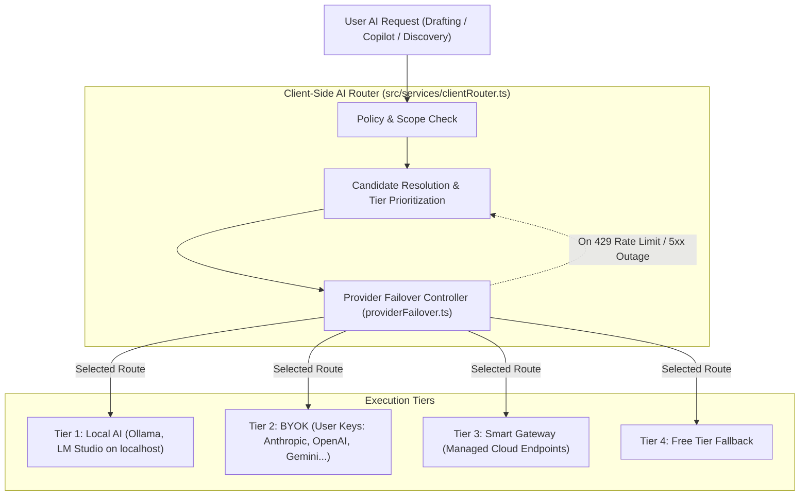

# AI Architecture & Routing System

This document specifies the current AI gateway, candidate resolution routing, multi-provider failover engine, local model runners, prompt engineering system, and error recovery policies in **Scholar Core**.

---

## 1. AI System Overview

Scholar Core does not bind to a single artificial intelligence model. Instead, it employs a multi-tiered, client-routed architecture that seamlessly coordinates cloud foundation models, user-supplied keys, and on-device local engines.

---

## 2. The 5 Operational AI Modes

Users configure their AI operating mode in `/ai-access`:

1. **Smart Gateway (Default)**:
   - Intelligent cloud routing that automatically selects the highest-performing available model for each specific academic task (e.g. Anthropic Claude for long-form synthesis, Google Gemini for wide-context literature analysis, Groq for instantaneous Copilot queries).
2. **Bring Your Own Key (BYOK)**:
   - Users provide their personal API keys. Calls utilize the user's quota directly. Supported providers:
     - OpenAI (`gpt-4o`, `o1`, `gpt-4o-mini`)
     - Anthropic (`claude-3-5-sonnet`, `claude-3-opus`, `claude-3-haiku`)
     - Google Gemini (`gemini-2.0-flash`, `gemini-1.5-pro`)
     - Groq (`llama-3.3-70b-versatile`, `mixtral-8x7b-32768`)
     - Mistral AI (`mistral-large`, `mistral-small`)
     - Cohere (`command-r-plus`, `command-r`)
     - xAI (`grok-2`, `grok-beta`)
     - OpenRouter & Together AI
3. **Free Tier**:
   - Access to standard model endpoints provided out of the box without requiring personal credentials.
4. **Local AI**:
   - Routes inference entirely to locally running engines on the user's machine (Ollama, LM Studio, vLLM, LocalAI) listening on standard loopback ports (`127.0.0.1:11434`, `127.0.0.1:1234`).
   - Ensures zero data egress for sensitive institutional research.
5. **Offline Mode**:
   - Hard network egress lock. All cloud API calls are disabled; only local offline engines and deterministic algorithms operate.

---

## 3. Client-Side Candidate Resolution (`clientRouter.ts`)

Candidate selection resolves at request time on the client:

1. **Task Categorization**:
   - Requests are tagged by capability requirement: `drafting` (high reasoning, long context), `copilot` (low latency, conversational), `discovery` (high search precision), `audit` (rule compliance and structural extraction).
2. **Preference Evaluation**:
   - Checks user preferences saved in `localStorage` / user profile. If a user has pinned a specific provider or model for that task, it is placed at the top of the candidate list.
3. **Hardware Profiling (`hardwareProfiler.ts`)**:
   - If Local AI is active, the system queries local device RAM, GPU availability, and model parameters to ensure the model will not trigger an out-of-memory error.
4. **Candidate Queue Assembly**:
   - Constructs an ordered priority queue of `(Provider, Model)` tuples to execute in sequence if failures occur.

---

## 4. Multi-Provider Failover Engine (`providerFailover.ts`)

The failover engine wraps all AI calls to guarantee high availability during upstream provider incidents:

- **Trigger Conditions**:
  - HTTP `429 Too Many Requests` (Rate limit or quota exhausted).
  - HTTP `500`, `502`, `503`, `504` (Provider server outage).
  - Network timeouts (configurable per task, default 30s).
- **Quarantine Policy**:
  - When a provider fails with 429 or 5xx, it is placed into quarantine with exponential backoff (starting at 60s, doubling up to 15 minutes).
  - While quarantined, subsequent requests automatically bypass this provider and route to the next candidate in the queue.
- **Failover Event Stream**:
  - The client UI emits non-blocking toast notifications when a failover occurs (e.g. *"Primary provider rate-limited. Seamlessly switched to secondary model"*), maintaining transparency without interrupting the user's workflow.

---

## 5. Local Runner Integration (`localRunnerCatalog.ts`)

Scholar Core automatically probes standard local runner ports on application startup:

| Runner | Default Host | Discovery Endpoint |
| :--- | :--- | :--- |
| **Ollama** | `http://localhost:11434` | `GET /api/tags` |
| **LM Studio** | `http://localhost:1234` | `GET /v1/models` |
| **vLLM** | `http://localhost:8000` | `GET /v1/models` |
| **LocalAI** | `http://localhost:8080` | `GET /v1/models` |

When a local runner is detected:
- The `/ai-access` interface displays green connectivity status.
- Available locally installed models (e.g. `llama3.3:latest`, `deepseek-r1:14b`, `mistral:latest`) are automatically populated into model selection dropdowns.

---

## 6. Prompt Engineering Architecture

Prompts in Scholar Core are strictly structured around academic requirements:

### 6.1 Phase Copilot Personas (`ContextPanel.tsx`)
- **Phase 1 · Advisor**: System prompt enforces structural decomposition, research question formulation, command verb unpacking, and academic level calibration.
- **Phase 2 · Librarian**: System prompt enforces bibliographic rigor, publication venue credibility, empirical relevance filtering, and evidence gap detection.
- **Phase 3 · Scribe**: System prompt enforces PEEL paragraph structure (Point, Evidence, Explanation, Link), target word budgets, and registered voice constraints.
- **Phase 4 · Examiner**: System prompt enforces objective rubric scoring, critical critique, and strict citation reconciliation.

### 6.2 Analytical Outline Generation (`outlineService.ts`)
- System prompt instructs the model to analyze the specific prompt, thesis, and discipline.
- Strictly forbids generic template outputs ("Introduction", "Body Paragraph 1", "Conclusion").
- Requires dynamic analytical headings reflecting the substantive arguments, variables, and case studies of the prompt.
- Enforces JSON output matching the `AssignmentStructure` schema.

### 6.3 Section Drafting Prompt (`server/routes/project/assignment.ts`)
- Contextual inputs:
  - Full Assignment Brief (Topic, Academic Level, Citation Style).
  - Selected Writing Style & Tone (e.g. *Analytical*, *Argumentative*, *Critical*, or syntax patterns extracted from user's custom essay).
  - Active Subheading Name and Author Guidance Notes.
  - Target Word Budget for this specific section.
  - Approved Evidence Items mapped to this section (including quotes and authors).
- Output constraints:
  - Generates cohesive academic prose with embedded in-text citations matching approved evidence.
  - Adheres strictly to the target word budget.

### 6.4 Adversarial Peer Review Simulator (`server/routes/project/agentic.ts`)
- Runs 5 concurrent specialized referee evaluations against the drafted manuscript:
  1. *Methodologist*: Assesses methodology, sampling, biases, and threats to internal/external validity.
  2. *Domain Specialist*: Checks foundational literature coverage and theoretical contributions.
  3. *Biostatistician*: Evaluates quantitative claims, statistical significance, and interpretations.
  4. *Synthesizer*: Reviews overall narrative progression and argumentative flow.
  5. *Formal Editor*: Inspects academic register, passive/active balance, and citation adherence.

---

## 7. AI Endpoints & Server API

All AI requests flow through structured endpoints:

- `GET /api/ai/models`: Returns list of available cloud models, latency stats, and active status.
- `POST /api/ai/verify-key`: Pings provider with user-supplied key to confirm validity before saving.
- `POST /api/ai/generate`: Standard synchronous generation request.
- `POST /api/ai/chat`: Conversational endpoint for Copilot personas.
- `POST /api/ai/stream`: Server-Sent Events (SSE) streaming endpoint for live real-time drafting text generation.
- `POST /api/ai/agent`: Complex multi-step reasoning endpoint for deep research and question deconstruction.
