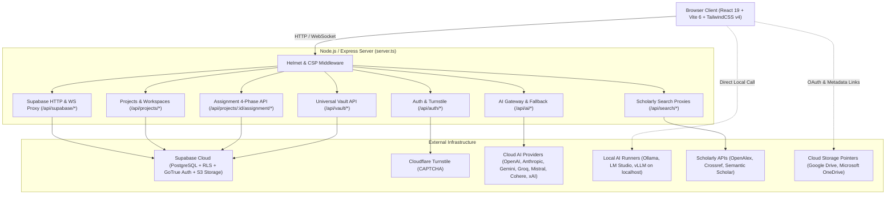

# Technical Architecture

This document specifies the current fullstack architecture, system topology, data flow, security model, and application layers of **Scholar Core**.

---

## 1. System Topology Overview

Scholar Core is architected as a hybrid single-container application in production and a unified fullstack development environment locally.

---

## 2. Technology Stack

### 2.1 Frontend Client
- **Runtime & UI**: React 19 (`react`, `react-dom`).
- **Language**: TypeScript 5.8 (configured with strict type checking in `tsconfig.json`).
- **Build Tooling & Bundler**: Vite 6 (`vite`, `@vitejs/plugin-react`).
- **Styling**: TailwindCSS v4 (`@tailwindcss/vite`, `tailwindcss`) augmented with semantic CSS custom properties in `src/index.css`.
- **Client Routing**: React Router DOM 7 (`react-router-dom`) with a unified `BrowserRouter` mounted at root.
- **Rich Text Editor**: TipTap 3 (`@tiptap/core`, `@tiptap/react`, `@tiptap/starter-kit`, `@tiptap/extension-placeholder`).
- **Animations & Transitions**: Motion 12 (`motion`).
- **Icons**: Lucide React (`lucide-react`).

### 2.2 Backend Server
- **Runtime**: Node.js 20+ / Express 4 (`express`, `express-async-errors`).
- **Language**: TypeScript executed via `tsx` during development and bundled via `esbuild` to CommonJS (`dist/server.cjs`) for production.
- **Security & Headers**: Helmet 8 (`helmet`) with tailored Content Security Policy (CSP).
- **Rate Limiting**: Custom token-bucket rate limiter middleware (`server/src/middleware/rateLimit.ts`).
- **Document Parsers**: Built-in AST extractors for PDF (`pdf-parse`), Word documents (`mammoth`, `docx`), plain text, and Markdown (`src/document_intelligence/parser/`).
- **File Ingestion**: Multer (`multer`) for handling multipart form uploads.

### 2.3 Database & Cloud Backend (Supabase)
- **Database Engine**: PostgreSQL 15+ managed via Supabase.
- **Access Model**: Dual-mode access:
  1. Direct PostgREST / Supabase Client (`@supabase/supabase-js`) with Row Level Security (RLS) for user-scoped queries.
  2. Express Backend Supabase Proxy (`server/routes/supabaseProxy.ts`) for unified reverse proxying and server-side operations.
- **Authentication**: Supabase GoTrue Auth supporting Email/Password, Magic Link, and Google OAuth.
- **Object Storage**: Supabase Storage (`project-files` bucket) for brief documents and lecture slides.

---

## 3. Major Application Layers

### 3.1 Client Routing Layer (`src/main.tsx` & `src/desk/DeskApp.tsx`)
The application operates on a single `BrowserRouter` hierarchy:
- `/admin/*`: Lazy-loaded Admin AI Infrastructure panel chunk (`AdminApp.tsx`).
- `/*`: Main Desk application (`DeskApp.tsx`):
  - **Public Routes**: `/`, `/signin`, `/signup`, `/reset-password`, `/verify-email`.
  - **Authenticated Routes** (enforced by `<RequireAuth>`):
    - `/onboarding`: Mandatory initial user profile configuration.
    - Gated by `<OnboardingGate>`:
      - `/projects`: Main projects list and dashboard.
      - `/projects/:projectId`: Project workspace router (dynamically mounts `AssignmentWorkspace`, `ThesisWorkspace`, `ProposalWorkspace`, `PresentationWorkspace`, or `ResearchWorkspace` based on `outputTypeId`).
      - `/projects/:projectId/:view`: Deep stage link within the workspace.
      - `/vault`: Universal Knowledge Vault screen.
      - `/ai-access` and `/ai-access/:section`: AI provider, local runner, and preference management.
      - `/settings`: Multi-account registry, active profile, and theme settings.

### 3.2 Workspace Routing & State Management
- Workspace state is managed through React Context (`AssignmentContext.tsx`, `ResearchContext.tsx`) coupled with atomic synchronization refs (`projectRef`) to prevent state loss during rapid edits.
- State is continuously debounced and synchronized with backend endpoints (`PUT /api/projects/:id/assignment`) which persist the canonical state into `public.assignment_projects` in Supabase.

### 3.3 Server Routes Layer (`server/routes/index.ts`)
The Express server modularizes routes across domain boundaries:
- `registerHealthRoutes`: `/health`, `/healthz`, `/api/health` probes.
- `registerAuthRoutes`: `/api/auth/verify-signup` with Turnstile token validation.
- `registerProjectRoutes`: CRUD for projects, stages, claims, evidence, and the dedicated 4-phase assignment endpoints (`server/routes/project/assignment.ts`).
- `registerAIRoutes`: Unified AI endpoints (`/api/ai/generate`, `/api/ai/chat`, `/api/ai/stream`, `/api/ai/models`).
- `registerAiAccessRoutes`: Provider credentials, BYOK encryption, and local runner detection.
- `registerVaultRoutes`: Universal Vault operations, DOI fetching, and cloud links.
- `registerSearchRoutes`: Proxied scholarly search queries to OpenAlex, Crossref, and Semantic Scholar.
- `registerSupabaseProxy`: Reverse proxy for Supabase PostgREST and Realtime WebSockets.

---

## 4. Security Architecture

### 4.1 Content Security Policy (CSP)
In production, Helmet enforces a strict CSP policy in `server.ts` configured with exact origins:
- `default-src`: `'self'`
- `connect-src`:
  - `'self'`
  - Exact Supabase Project URL (`https://<project-ref>.supabase.co` and `wss://<project-ref>.supabase.co`)
  - Direct Browser Cloud Origins (Google Gemini API: `https://generativelanguage.googleapis.com`)
  - Local AI Runners (`http://localhost:*`, `http://127.0.0.1:*`)
  - Scholarly Discovery APIs (`https://api.openalex.org`, `https://api.crossref.org`, `https://api.semanticscholar.org`, `https://api.datacite.org`)
  - Cloud Drive APIs (`https://www.googleapis.com`, `https://graph.microsoft.com`)
- `script-src`: `'self'`, Cloudflare Turnstile (`https://challenges.cloudflare.com`)
- `frame-src`: `'self'`, Cloudflare Turnstile (`https://challenges.cloudflare.com`)

### 4.2 Bot Abuse Protection
- User registration requires a Cloudflare Turnstile CAPTCHA token.
- Verification is performed on the server via `server/src/middleware/captchaVerify.ts` against Cloudflare's siteverify API before account creation proceeds.

### 4.3 Tenant Isolation & Database Security
- Every relational table in Supabase enforces Row Level Security (RLS).
- Read, write, and delete operations check `auth.uid() = user_id`, guaranteeing that users can only access their own projects, vault items, and credentials.
- Multi-Account switching manages active sessions via Supabase auth tokens, maintaining strict isolation across profiles.

### 4.4 Envelope Encryption for Credentials
- User-provided BYOK keys (OpenAI, Anthropic, etc.) stored in the database are encrypted using envelope encryption primitives (`src/services/crypto/crypto.ts`) with user-scoped keys.
