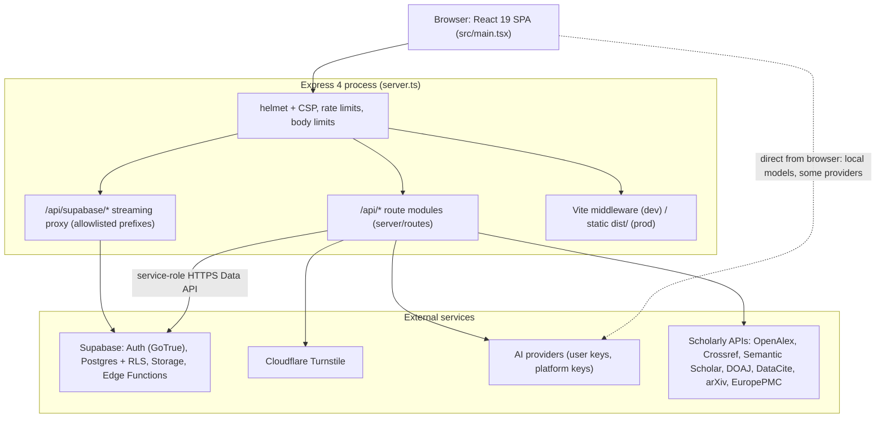

# Technical Architecture

Runtime topology, server and client layers, and the security model. Paths are relative to the repository root.

## 1. Topology

One Node process (`server.ts`) serves the API, proxies Supabase, and serves the SPA (Vite middleware in development, `dist/` in production).

Process start order in `server.ts`: helmet and CSP, request-header redaction, Supabase proxy (before body parsers so streams stay unbuffered), JSON and URL-encoded body parsers (limit derived from `MAX_UPLOAD_MB`), parser and agent registration (`registerDefaultParsers`, `registerBuiltinAgents`), citation formatter registration, then route registration, `errorHandler`, and finally Vite middleware or static files. Process-level `unhandledRejection` and `uncaughtException` handlers log and keep the server up; `SIGTERM`/`SIGINT` close the HTTP server (forced exit after 10 s).

## 2. Technology

| Area | Choice (from `package.json`) |
| :--- | :--- |
| Client | React 19, react-router-dom 7, Vite 6, Tailwind CSS v4 (`@tailwindcss/vite`), TipTap 3, motion, lucide-react, @dnd-kit |
| Server | Express 4 (`express-async-errors`), helmet 8, multer 2, run with `tsx` in development and bundled by esbuild to `dist/server.cjs` (`--packages=external`) |
| Language | TypeScript ~5.8, strict; path alias `@/*` resolves to the repository root |
| Validation | zod 4 |
| AI libraries | `@google/genai`, LangChain core / OpenAI and LangGraph (`server/services/briefScannerGraph.ts`) |
| Documents | `pdf-parse`, `mammoth`, `docx`, `pdfmake`, `pptxgenjs`, `jszip` |
| Data | `@supabase/supabase-js` (client), Supabase Data API over HTTPS from the server, optional `pg` direct connection |
| Tests | Vitest 4 + Testing Library (unit and route tests), Playwright + axe (end to end) |

## 3. Server layer

### 3.1 Route modules (`server/routes/`)

Registered in `server.ts` in this order: health, admin, auth, `/api/ai/run` and `/api/ai/models`, AI routes, studio, projects, drafting, AI access, search, vault, presentations. Full endpoint list: [`API.md`](API.md).

| Module | Mount |
| :--- | :--- |
| `health.ts` | `GET /api/health` |
| `admin.ts` | `/api/admin/ai/*` (`requireAuth` then `requireAdmin`, scope checks) |
| `auth.ts` | `/api/auth/verify-signup`, `/login`, `/check-availability` |
| `aiRun.ts` | `POST /api/ai/run`, `GET /api/ai/models` |
| `ai.ts` | `/api/ai/*`: status, search, deep research, agent, threads |
| `studio.ts` | `/api/studio/*` (voice profile, refine, consent, restrict, egress audit) |
| `project.ts` | `/api/projects/*` and `/api/atlas/output-types`, `/api/user/saved-authors`; mounts the sub-routers in `server/routes/project/` |
| `drafting.ts` | `POST /api/drafting/section` |
| `aiAccess.ts` | `/api/ai-access/*` |
| `search.ts` | `/api/search/*` and the alias `/api/discovery/*` |
| `vault.ts` | `/api/vault/*` and `POST /api/lookup-doi` |
| `presentations.ts` | `/api/presentations/*` |
| `supabaseProxy.ts` | `/api/supabase/*` (HTTP) and WebSocket upgrade |

Project sub-routers (`server/routes/project/`): `agentic/` (journal pipeline, split into blueprint, citation support, drafting, evidence, journal profile, references, review routers), `assignment/` (extract, understand, sources, drafting, submission, agent routes), `thesis.ts`, `proposal.ts`, `presentation.ts` (+ `presentationCards.ts`), `claims.ts`, `evidence.ts`, `files.ts`, `activity.ts`, `parse.ts`, `mesh.ts`, `journal_compliance.ts`, `submissions.ts`, and `core/` (manuscript, gate, export handlers).

### 3.2 Middleware (`server/src/middleware/`)

| File | Role |
| :--- | :--- |
| `auth.ts` | `requireAuth`: verifies the Supabase access token with a direct GoTrue call (no supabase-js client), bounded in-memory token cache; 401 for bad tokens, 503 when verification cannot be performed |
| `requireAdmin.ts` | Admin roster check, `MAIN_ADMIN_EMAIL` super-admin, scope enforcement (`requireScope`, `requireScopeInline`) |
| `rateLimit.ts` | Fixed-window in-memory limiter, keyed by client IP (Cloudflare-aware; only trusts `CF-Connecting-IP` when the peer is a Cloudflare address) |
| `captchaVerify.ts` | Turnstile token verification for sign-up |
| `rejectClientCredentials.ts` | Rejects provider credentials in request bodies on AI routes |
| `uploadGuard.ts` | Multer memory storage, `MAX_UPLOAD_MB` (default and hard ceiling 10), heavy-parser detection |
| `errorHandler.ts`, `asyncHandler.ts` | Uniform error responses |

Rate limits actually applied (fixed window, per client IP): AI abuse limit 20/min on `/api/ai/run`, `/api/ai/models` and the `/api/ai/*` router; studio routes 200/min; project routes 600/min; Supabase proxy 300/min; saved AI keys 120 per 15 min (`/api/ai-access/keys`); auth routes use their own limiters (login 5 per 5 min, availability 30 per 15 min, signup verification 20 per 15 min).

### 3.3 Persistence (`src/services/store/projectStore.ts`)

Projects are persisted through `resolveStore()`: (1) Supabase Data API over HTTPS when `VITE_SUPABASE_URL` and `SUPABASE_SERVICE_ROLE_KEY` are set (`restProjectStore.ts`, `server/src/supabaseRest.ts`); (2) direct Postgres when `DATABASE_URL` is set (`pgProjectStore.ts`); (3) an on-disk store (`data/.scholar_local_store.json`) in non-production; in production the server throws at start rather than run without durable storage. Tests use an in-memory store. `GET /api/health` reports `persistenceMode` as `supabase-rest`, `postgres`, `in-memory-test` or `in-memory-EPHEMERAL` (the last also appears in an unconfigured development run).

Ownership is enforced in application code: the server holds the service-role key, and `projects` has RLS enabled with no policies (see [`DATA-MODEL.md`](DATA-MODEL.md)).

### 3.4 AI layer

`server/src/services/scholarBrain.ts` is the only AI brain. Routing, credentials and providers are documented in [`AI-SYSTEM.md`](AI-SYSTEM.md); entry layers in [`AI-CALL-MAP.md`](AI-CALL-MAP.md). Supporting modules: `server/src/aiEngine/` (routers, credits, quotas, entitlements, credential vault, provider health), `server/src/ai/` (client AI config, endpoint guard, router bridge), `server/src/research/` (web search, deep research, citation validator, scholarly retrieval), `server/src/discovery/` (live search, blueprint scout), `server/src/services/semanticRagEngine.ts`.

### 3.5 Shared code

The server imports from `src/` (citation formatters, `document_intelligence`, mesh agents, `platform/` gateway, router and warden, `config/` catalogs). Those modules must stay free of browser-only APIs. SSRF-sensitive fetches of user-supplied URLs go through `server/utils/ssrfGuard.ts` (HTTP/HTTPS only, DNS pre-resolution with private-range blocking, connection pinning, per-hop redirect validation, 2 MB and 8 s caps).

## 4. Client layer

### 4.1 Routing

`src/main.tsx` mounts `/admin/*` (lazy `src/admin/AdminApp.tsx`) and `/*` (`src/desk/DeskApp.tsx`).

| Route | Access |
| :--- | :--- |
| `/`, `/signin`, `/signup` | Public (landing or projects list) |
| `/signup/check-email`, `/signup/resend`, `/reset-password` | Public only |
| `/reset-password/confirm`, `/verify-email` | Public |
| `/presentation` | Public (works signed out) |
| `/onboarding` | Signed in |
| `/projects`, `/projects/:projectId`, `/projects/:projectId/:view` | Signed in and onboarded |
| `/vault`, `/ai-access`, `/ai-access/:section`, `/settings` | Signed in and onboarded |
| `/presentation` (inside the gate) | Signed in and onboarded |
| `/agents`, anything else | Redirect to `/projects` |

`ProjectRoute` loads the project and chooses the workspace from `outputTypeId` ([`PRODUCT.md`](PRODUCT.md) §2). The signed-in routes sit behind `RequireAuth`, `RequireOnboarding` and `OnboardingGate`.

### 4.2 Source layout

| Path | Contents |
| :--- | :--- |
| `src/desk/` | UI by feature: assignment, thesis, journal, workspace (journal studio), proposal, presentation, vault, aiAccess, ai, auth, account, admin, dashboard, intake, setup, claims, evidence, gates, discovery, export, manuscript, editor |
| `src/desk/api/` | Typed client: `client.ts` (authenticated fetch, transient `x-ai-*` headers on AI routes via `routeUsesClientAi`, offline queue), `projectsApi.ts`, `agenticApi.ts`, `claimEvidenceApi.ts`, `studioGenerationApi.ts` |
| `src/app/` | Client engines: `atlas` (output-type catalog), `conductor` (gates), `mesh` (agent registry and executor), `citation`, `manuscript`, `review`, `coherence`, `rubric`, `studio`, `journal`, `anonymization`, `coverLetter`, `export` |
| `src/domain/` | Pure models and zod schemas; no React and no I/O |
| `src/features/` | `slides` (Presentation Studio and Gamma card engine), `coursework` (style engine, legacy coursework components), `drafting`, `sources`, `understand` |
| `src/platform/` | `gateway/` (provider adapters, failover), `router/` (request router, circuit breaker, model curation, SSE bridge), `warden/` (egress policy, consent) |
| `src/services/` | Auth, Supabase client, vault, store, offline queue, crypto, capabilities, AI settings and diagnostics |
| `src/citation_compliance/` | Formatters, validation, CSL engine, BibTeX/RIS importers |
| `src/config/` | `providerCatalog.ts`, `modelCatalog.ts`, `localRunnerCatalog.ts` |
| `src/shared/` | Cross-cutting helpers (project state schema, LLM JSON parser, guardrails, style weights) |

### 4.3 State

Coursework state lives in `AssignmentContext` and is saved as keyed answers through `PATCH /api/projects/:id/intake` into `projects.answers`; journal state lives in `ResearchContext`. Typed access to saved answers goes through `src/shared/projectStateSchema.ts`.

### 4.4 Code splitting

`vite.config.ts` splits `react`, `tiptap`, `supabase`, `ui`, `docx`, `pdfmake` and parser dependencies into their own chunks, and workspaces are lazy-loaded in `DeskApp.tsx`. `scripts/verify-chunk-budget.mjs` (run by `npm run build`) fails the build if any JavaScript chunk exceeds 500 kB (`CHUNK_BUDGET_KB` overrides).

## 5. Security model

- **Authentication**: Supabase Auth. Sign-up requires a Turnstile token verified server-side; `/api/auth/login` accepts email, username or phone and answers failures with one uniform message.
- **Authorization**: `requireAuth` on every project, vault, AI-access, search, presentation, drafting and studio route; project ownership checked per request; admin routes require an admin roster entry and the relevant scope.
- **CSP** (production, `server.ts`): `connect-src` allows self, the Supabase origin (https and wss), direct-call provider origins from the provider catalog, `localhost`/`127.0.0.1` for local runners, the scholarly APIs (OpenAlex, Crossref, DataCite, EuropePMC, DOAJ, Semantic Scholar, arXiv), World Bank and OECD, Cloudflare challenges, Google Fonts and Google accounts. `script-src` is self, Turnstile, Google accounts and one hashed inline theme script (`INLINE_THEME_SCRIPT_CSP_HASH`, checked by `npm run verify:csp-hash`). `frame-src` is self, Turnstile and Google accounts.
- **Supabase proxy**: only `/auth/v1`, `/rest/v1`, `/storage/v1`, `/functions/v1` and `/realtime/v1` are forwarded; fails closed when no upstream is configured.
- **Credentials**: a user's key is sent per request in `x-ai-*` / `x-ai-keyring` headers and held in memory for that request only; handlers never log it (`x-ai-api-key` is redacted in `server.ts`) and request bodies may not carry credentials (`rejectClientCredentials`). Keys a user chooses to save for device sync (`user_provider_keys`, via `/api/ai-access/keys`) and the platform's own provider keys (`platform_provider_credentials`) are envelope-encrypted: a per-credential key wrapped under `MASTER_KEY` (`server/src/aiEngine/credentialVault.ts`, `userKeyVault.ts`). Only the owner's own request can read back saved user keys.
- **Outbound requests**: user-named AI base URLs must be https and public (`server/src/ai/aiEndpointGuard.ts`); the generic provider proxy applies an equivalent check; page fetches use `ssrfGuard`.
- **Uploads**: in-memory, ceiling 10 MB, heavy parsers (PDF, Office) tracked by `uploadGuard`.
- **Database**: all tables have RLS enabled; server-owned tables carry no policies and are reachable only with the service-role key.
- Deeper security history: `AUDIT.md`, `ROTATION_RUNBOOK.md`, `HOTFIX*_DEPLOY.md` (dated records).

## 6. ML style engine (`ml-style-engine/`)

An offline pipeline that trains an archetype classifier; only its exported weights ship in the app.

- **Corpus**: `ml-style-engine/corpus/<archetype>/` holds 10 open-access papers (EuropePMC) for each of 11 archetypes: `essay`, `literature_review`, `research_paper`, `case_study`, `report`, `critical_essay`, `argumentative_essay`, `policy_analysis`, `business_assignment`, `journal_article`, `presentation_slides`. 110 documents, 752,811 words in total (`corpus_manifest.json`).
- **Scripts**: `01_download_exact_90_files.py`, `02_verify_corpus.py`, `03_train_model.py`, `04_expand_corpus_110_files.py` (Python, scikit-learn; not part of `npm` scripts).
- **Model**: `models/archetype_classifier_meta.json` records the selected calibrated LinearSVC (cross-validation accuracy 0.9397, macro F1 0.9397) against multinomial naive Bayes (0.9318) and L2 logistic regression (0.9308), 5,000-term vocabulary, 8,154 training samples. `03_train_model.py` writes `models/model_weights.json` and copies the runtime weights to `src/features/coursework/data/archetype_model_weights.json`.
- **Runtime**: `src/features/coursework/services/styleEngineService.ts` classifies text (`classifyArchetype`), computes style metrics (`extractStyleMetrics`) and builds a compliance report (`auditStyleCompliance`) in TypeScript. It is used by `src/features/coursework/` and `src/desk/manuscript/ManuscriptGenerationPanel.tsx`; `scholarBrain.getArchetypeModelWeights()` exposes the weights to server code.
