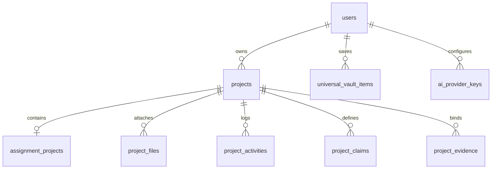

# Data Model & Schema Specification

This document specifies the current data structures, TypeScript interfaces, PostgreSQL tables, JSONB schemas, and persistence models in **Scholar Core**.

---

## 1. Domain Entities & TypeScript Schemas

### 1.1 Project (`ProjectView` & `Project`)
- **Purpose**: Represents an academic research deliverable project created by a user.
- **Location**: `src/desk/types.ts` & `src/domain/project/types.ts`.
- **Fields**:
  - `id`: string (UUID) — Unique project identifier.
  - `userId`: string — Foreign key to owner account.
  - `title`: string — Project title.
  - `outputTypeId`: string — Identifier for deliverable format (`OT-01`, `OT-10`, `OT-09`, `OT-19`, `OT-22`).
  - `state`: ProjectState — Current workflow phase/stage state and progress metadata.
  - `authors`: ProjectAuthor[] — Array of project contributors with affiliations and email.
  - `createdAt`: string — ISO 8601 timestamp.
  - `updatedAt`: string — ISO 8601 timestamp.
- **Relationships**:
  - Belongs to `User`.
  - Has one `AssignmentProjectState` (for `OT-01`).
  - Has many `ProjectFile`, `ProjectActivity`, `ProjectClaim`, and `ProjectEvidence`.

---

### 1.2 Coursework & Essay State (`AssignmentProjectState`)
- **Purpose**: Canonical state container for the 4-phase Coursework & Essay workflow (`OT-01`).
- **Location**: `src/desk/assignment/types.ts`.
- **Persistence**: Stored as a JSONB document in `public.assignment_projects.state`.
- **Top-Level Sections**:
  ```typescript
  export interface AssignmentProjectState {
    projectId: string;
    brief: AssignmentBrief;
    sources: AssignmentSourcesState;
    drafting: AssignmentDraftingState;
    submission: AssignmentSubmissionState;
    updatedAt: string;
  }
  ```

#### Detailed Sub-Schemas:
- **`AssignmentBrief` (Phase 1 State)**:
  - `prompt`: string — Raw text prompt or parsed document text.
  - `academicLevel`: `"undergraduate"` | `"postgraduate"`
  - `assignmentType`: `"analytical_essay"` | `"argumentative_essay"` | `"critical_review"` | `"report"` | `"case_study"`
  - `citationStyle`: `"apa7"` | `"harvard"` | `"mla9"` | `"chicago_author_date"` | `"ieee"`
  - `targetWordCount`: number — Target word budget for full deliverable.
  - `writingTone`: string — Selected academic style (e.g. `"analytical"`, `"critical"`, `"natural_engaging"`).
  - `writingStyle`: string — Descriptive voice profile.
  - `customVoiceSample`?: string — Past essay text pasted for voice cloning.
  - `structure`: `AssignmentStructure` — The confirmed analytical outline.
  - `metadata`: `{ moduleCode?: string; moduleName?: string; university?: string; dueDate?: string }`.
- **`AssignmentStructure`**:
  - `version`: number — Structure version tracker.
  - `isLocked`: boolean — Confirmation lock status.
  - `mainHeadings`: `AssignmentMainHeading[]`
- **`AssignmentMainHeading`**:
  - `id`: string — Unique heading ID.
  - `title`: string — Substantive analytical heading title.
  - `order`: number — Order index.
  - `subheadings`: `AssignmentSubheading[]`
- **`AssignmentSubheading`**:
  - `id`: string — Unique subheading ID.
  - `title`: string — Substantive subheading title.
  - `targetWords`: number — Word count budget allocated to this subheading.
  - `authorNotes`?: string — Guidance or instructions for drafting.
  - `researchStatus`: `"not_started"` | `"researching"` | `"limited_evidence"` | `"sufficient"` | `"gap"`
- **`AssignmentSourcesState` (Phase 2 State)**:
  - `curatedSources`: `CuratedSource[]` — Discovered literature.
  - `approvedReferences`: `ApprovedReference[]` — User-approved sources assigned to subheadings.
  - `uploadedLectureMaterials`: `LectureMaterial[]` — User course slides and lecture notes.
- **`AssignmentDraftingState` (Phase 3 State)**:
  - `sections`: Record<string, { content: string; wordCount: number; isComplete: boolean }> — Keyed by subheading ID.
  - `activeSectionId`: string — Currently selected section in the editor.
- **`AssignmentSubmissionState` (Phase 4 State)**:
  - `rubricScores`: `RubricEvaluationScore[]` — Scores across 10 academic dimensions.
  - `citationAudit`: `{ inTextCitations: string[]; bibliographyEntries: string[]; discrepancies: string[] }`.

---

### 1.3 Sources & Scholarly Literature

#### `CuratedSource`
- **Purpose**: Represents a peer-reviewed or scholarly source discovered by the research engine.
- **Fields**:
  - `id`: string — Unique identifier.
  - `title`: string — Article or book title.
  - `authors`: string[] — List of author names.
  - `year`: number — Publication year.
  - `venue`: string — Journal name, conference, or publisher.
  - `doi`?: string — Digital Object Identifier.
  - `url`?: string — Direct web link.
  - `abstract`: string — Article abstract or summary.
  - `roleInAssignment`: `"Empirical evidence"` | `"Theoretical framework"` | `"Comparative evidence"` | `"Core theory"` | `"Methodological framework"`
  - `relevanceCategory`: `"Very High"` | `"High"` | `"Moderate"`
  - `sourceOrigin`: `"USER UPLOADED"` | `"SYSTEM FOUND"` | `"USER ADDED"` | `"ACADEMIC"` | `"PRIMARY SOURCE"`
  - `whyThisSource`: string — Contextual justification explaining relevance to the assignment.

#### `ApprovedReference`
- **Purpose**: Represents a source confirmed by the user and assigned to specific outline subheadings.
- **Fields**:
  - `id`: string — Reference ID.
  - `sourceId`: string — Linked `CuratedSource` ID.
  - `mappedSubheadingIds`: string[] — Array of Phase 1 subheading IDs this source supports.
  - `canonicalCitation`: string — Pre-formatted in-text citation (e.g., `Smith (2024)`).
  - `bibliographyEntry`: string — Full bibliography entry formatted in the project's citation style.

---

### 1.4 Knowledge Vault Item (`UniversalVaultItem`)
- **Purpose**: Canonical cross-project reference in the Knowledge Vault under the Zero-Retention policy.
- **Location**: `src/desk/types.ts` & `src/services/vaultContents.ts`.
- **Fields**:
  - `id`: string — UUID.
  - `userId`: string — Owner account ID.
  - `title`: string — Item title.
  - `authors`: string[] — Authors list.
  - `year`: number — Publication year.
  - `itemType`: `"journal_article"` | `"book"` | `"conference_paper"` | `"report"` | `"dataset"` | `"cloud_doc"`
  - `doi`?: string — Digital Object Identifier.
  - `cloudStoragePointer`?: `{ provider: "google_drive" | "onedrive"; fileId: string; viewUrl: string }`
  - `tags`: string[] — User-defined taxonomic tags.
  - `linkedProjectIds`: string[] — Array of project IDs referencing this source.

---

### 1.5 User Profile & Multi-Account (`AccountProfile`)
- **Purpose**: Models the user identity, academic affiliation, and active profile in the multi-account registry.
- **Location**: `src/desk/types.ts` & `src/config/accountSchema.ts`.
- **Fields**:
  - `id`: string — Auth UUID.
  - `email`: string — User email address.
  - `fullName`: string — Scholar's full name.
  - `institution`: string — University or research organization.
  - `discipline`: string — Academic domain (e.g., Computer Science, Political Science, Medicine).
  - `academicRole`: `"undergraduate"` | `"postgraduate"` | `"phd"` | `"faculty"`
  - `defaultCitationStyle`: `"apa7"` | `"harvard"` | `"mla9"` | `"chicago"` | `"ieee"`
  - `theme`: `"dark"` | `"light"`
  - `accountStatus`: `"active"` | `"restricted"` | `"suspended"`

---

## 2. PostgreSQL Relational Database Schema (Supabase)



### Table Definitions

#### `public.projects`
- `id` (uuid, primary key, default `gen_random_uuid()`)
- `user_id` (uuid, references `auth.users(id)` on delete cascade)
- `title` (text, not null)
- `output_type_id` (text, not null)
- `state` (jsonb, default `'{}'::jsonb`)
- `authors` (jsonb, default `'[]'::jsonb`)
- `created_at` (timestamptz, default `now()`)
- `updated_at` (timestamptz, default `now()`)
- *RLS*: Enabled (`auth.uid() = user_id`).

#### `public.assignment_projects`
- `project_id` (uuid, primary key, references `public.projects(id)` on delete cascade)
- `state` (jsonb, not null)
- `created_at` (timestamptz, default `now()`)
- `updated_at` (timestamptz, default `now()`)
- *RLS*: Enabled via project join (`projects.user_id = auth.uid()`).

#### `public.universal_vault_items`
- `id` (uuid, primary key, default `gen_random_uuid()`)
- `user_id` (uuid, references `auth.users(id)` on delete cascade)
- `title` (text, not null)
- `authors` (text[], default `'{}'`)
- `year` (int)
- `item_type` (text, not null)
- `doi` (text)
- `cloud_storage_pointer` (jsonb)
- `canonical_reference` (jsonb)
- `tags` (text[], default `'{}'`)
- `linked_project_ids` (uuid[], default `'{}'`)
- `created_at` (timestamptz, default `now()`)
- *RLS*: Enabled (`auth.uid() = user_id`).

#### `public.project_files`
- `id` (uuid, primary key, default `gen_random_uuid()`)
- `project_id` (uuid, references `public.projects(id)` on delete cascade)
- `user_id` (uuid, references `auth.users(id)` on delete cascade)
- `filename` (text, not null)
- `file_size` (bigint, not null)
- `mime_type` (text, not null)
- `storage_path` (text, not null)
- `created_at` (timestamptz, default `now()`)
- *RLS*: Enabled (`auth.uid() = user_id`).

#### `public.ai_provider_keys`
- `id` (uuid, primary key, default `gen_random_uuid()`)
- `user_id` (uuid, references `auth.users(id)` on delete cascade)
- `provider` (text, not null)
- `encrypted_key` (text, not null)
- `created_at` (timestamptz, default `now()`)
- `updated_at` (timestamptz, default `now()`)
- *RLS*: Enabled (`auth.uid() = user_id`).
