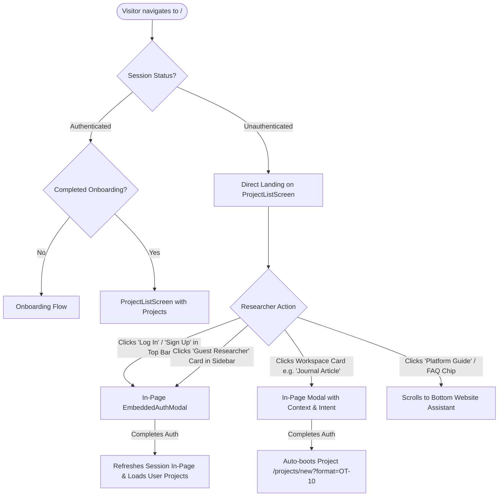

# Direct Landing Workspace & In-Page Authentication Specification

## Overview

This document specifies the direct landing page architecture, in-page authentication system, and bottom Website Assistant in **Scholar Core**.

---

## 1. Core Architectural Requirements

1. **Direct Landing Command Center**:
   - Visitors navigating to `https://scholar.gkshah.com.np/` (or `/`, `/signin`, `/signup`) immediately land on the full academic command center workspace (`ProjectListScreen.tsx`) without full-page redirects away to separate auth walls.
   - The primary canvas displays the hero inquiry (*"What would you like to write today?"*), the 4 curated workspace format cards (*Assignment*, *Journal Article*, *Research Proposal*, *Presentation*), and the active project registry (`Active Projects 0 of 0`) with the empty-state card.

2. **In-Page Authentication ("Sign In on This Page Only")**:
   - Authentication is rendered contextually via `EmbeddedAuthModal` on top of the workspace.
   - Supports Google One-Tap / OAuth, Email/Password login, new researcher registration, and switching accounts.
   - Preserves researcher context: clicking any workspace format card while unauthenticated triggers the modal with an informative context notice (e.g. *"Sign in to create your Journal Article project"*), automatically launching that workspace format upon successful authentication via `?newFormat=<formatId>`.

3. **Minimal Website Assistant**:
   - Positioned at the bottom of the page (`#website-assistant`) to provide strictly bounded guidance on navigating Scholar Core and utilizing its features.
   - Strictly limited to platform help: AI engine setup & BYOK, Knowledge Vault provenance, creating projects, Evidence phase & sourcing, Journal Article 25-stage pipeline, finding projects, and provider configuration.
   - Strictly refuses general writing, coding, web search, or document generation with polite redirection to the relevant dedicated workspace.
   - Minimal conversational UI: Conversation stream → simple text input → Send button. Strictly no attachments, no file uploads, no voice inputs, and no model selectors.

---

## 2. Routing & Authentication Flow



### Route Configurations (`DeskApp.tsx` & `DeskAuthGate.tsx`)

- **`RootOrProjectsRoute`**:
  - Handles `/`, `/signin`, and `/signup`.
  - When unauthenticated, renders `ProjectsIndexRoute` directly, opening `EmbeddedAuthModal` if the route is `/signin` or `/signup`.
  - When authenticated, redirects to `/projects` protected inside `RequireAuth` -> `RequireOnboarding` -> `OnboardingGate`.
- **`RequireAuth`**:
  - Unauthenticated hits to protected deep-links (e.g. `/projects/:id`) redirect to `/signin?redirect=${redirect}` so the user lands on the workspace with the auth modal pre-opened and returns to their destination upon sign-in.
- **`OnboardingGate`**:
  - Guest sessions bypass onboarding checks: `if (session.status !== "signed-in") return <Outlet />;`.

---

## 3. Visual & Functional Components

### 3.1 Header Sticky Top Bar
- When `!userEmail`: Displays **Log In** (ghost button) and **Sign Up** (solid dark pill button) in the sticky top bar next to theme and notification controls.
- When `userEmail`: Displays the full active researcher profile and quick project shortcuts.

### 3.2 Sidebar Profile Card (`UserAccountMenu.tsx`)
- Unauthenticated visitors see a guest profile card:
  ```tsx
  <button onClick={onOpenAuth} className="...">
    <Avatar initials="GR" />
    <div>
      <p className="font-semibold">Guest Researcher</p>
      <p className="text-blue-600">Sign In / Register →</p>
    </div>
  </button>
  ```
- Authenticated researchers see their name, institution, tier badge, and account switching popover.

### 3.3 Main Command Center Layout
Strictly aligns with the flagship visual design:
1. **Hero Title**: *"What would you like to write today?"* (`text-3xl font-bold tracking-tight`).
2. **Sub-headline**: *"Select a research blueprint to initialize your academic workspace."*
3. **4 Academic Workspace Cards** (4-column responsive grid):
   - **Assignment** (`OT-01`): Structured essays, coursework, and term papers with rubric compliance.
   - **Journal Article** (`OT-10`): Empirical research, IMRaD manuscripts, and systematic reviews.
   - **Research Proposal** (`OT-22`): Grant applications, thesis proposals, and methodology design.
   - **Presentation** (`OT-04`): Defense slides, conference presentations, and lecture decks.
4. **Active Projects**:
   - Header with count indicator (`Active Projects 0 of 0`) and search bar.
   - Empty state card: *"Initialize your first project"* with `[Browse Templates]` and `[Import from Zotero / PDF]` secondary actions.

### 3.4 In-Page Website Assistant (`#website-assistant`)
- Located at the bottom of the canvas with a clear section heading: *"Scholar Core Platform Guide & Assistant"*.
- Contains 10 interactive starter chips:
  1. *How do I set up AI?*
  2. *What is Knowledge Vault?*
  3. *How do I create a research project?*
  4. *What is the Evidence phase?*
  5. *How do I add sources?*
  6. *What does this feature do?*
  7. *Where can I find my projects?*
  8. *How does the Journal Article workflow work?*
  9. *What is Scholar AI Engine?*
  10. *How do I configure an AI provider?*
- Conversation thread records assistant answers with clear formatting and references to specific Scholar Core features.
- Out-of-scope query guard: Refuses general writing, coding, or homework solving, directing users to the appropriate structured workspace.

---

## 4. Test & Verification Coverage

Automated tests in `src/desk/__tests__/ProjectListScreen.test.tsx` verify:
- Unauthenticated guest access renders the full landing page without redirects.
- Clicking workspace cards opens the in-page auth modal with custom intent context.
- Top-bar "Log In" and "Sign Up" triggers open the auth modal.
- Sidebar "Platform Guide" button scrolls smoothly to `#website-assistant`.
- Website Assistant answers platform queries and refuses out-of-scope writing requests.
- All 75 test suites (599 tests) across `src/desk/` pass with zero regressions.
