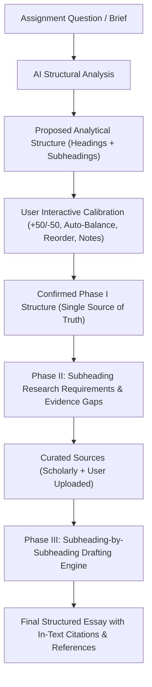

# Phase I: Dynamic Structure, Research, and Drafting Workflow

## Executive Summary & Core Architecture

In the Scholar OS Coursework & Essay module, the structure defined in **Phase I (Understand & Structure)** serves as the **dynamic, single source of truth** across all subsequent phases:
* **Phase I (Understand & Plan)**: Analyze assignment question → Generate dynamic analytical outline → Calibrate section word budgets → Confirm structure.
* **Phase II (Sources & Evidence)**: Connect literature discovery directly to confirmed subheadings → Identify evidence gaps → Map user and scholarly sources → Provide "Why this source?" justifications.
* **Phase III (Drafting)**: Draft section-by-section and subheading-by-subheading against the exact Phase I structure with persistent citation styles.
* **Phase IV (Submission & Review)**: Audit draft against rubric, structural compliance, and citation accuracy.



---

## 1. Dynamic Analytical Essay Structure (Elimination of Hardcoded Frameworks)

### Why Hardcoded Structures Fail
Traditional writing tools impose a static `Introduction / Body Paragraphs / Conclusion` outline regardless of whether the assignment is an undergraduate critical literature review, a postgraduate international relations policy analysis, or an empirical case study. This disconnects the research engine from the actual analytical requirements of the question.

### The Solution: Prompt-Calibrated Analytical Structure
When an assignment question is entered (e.g., *"Critically assess China's regional security strategy in South Asia since 2020"*), Scholar OS deconstructs the prompt and dynamically proposes analytical headings and subheadings:

* **Heading 1: Conceptual and Theoretical Framework**
  * 1.1 Regional Security Complexes and Hegemonic Theory (300 words)
  * 1.2 Balance of Power vs. Bandwagoning in South Asia (300 words)
* **Heading 2: Strategic Posturing & The String of Pearls (2020–Present)**
  * 2.1 Maritime Infrastructure: Gwadar and Hambantota Ports (450 words)
  * 2.2 Sino-Indian Border Dynamics and Bilateral Friction (450 words)
* **Heading 3: Economic Statecraft and Debt Vulnerabilities**
  * 3.1 Belt and Road Investments: Sri Lanka, Pakistan, and Bangladesh (400 words)
  * 3.2 Diplomatic Alignment vs. Sovereignty Concerns (400 words)
* **Heading 4: Regional Counterbalances and Strategic Synthesis**
  * 4.1 Quad Engagements and Indian Counter-Initiatives (350 words)
  * 4.2 Comprehensive Evaluation of South Asian Security Trajectories (350 words)

Each section is explicitly derived from the prompt, with calibrated default word counts tailored to the assignment's overall word limit.

---

## 2. User Control & Word Allocation Engine

The AI-generated structure is a starting recommendation; the user maintains full editorial and architectural authority:

### Outline Manipulation
* **Inline Renaming**: Click and edit main headings or subheadings with automatic real-time synchronization.
* **Addition & Removal**: Add new main analytical headings (automatically provisioned with subheadings) or subheadings within any section.
* **Reordering**: Move headings and subheadings up or down in the analytical sequence.
* **Section Author Notes**: Attach specific instructions (e.g., *"Focus on empirical data from 2023 onwards; emphasize debt sustainability"*) that are passed directly to AskScholar and the drafting engine.

### Precision Word Count Management
* **`+50` / `-50` Controls**: Rapidly increment or decrement section word counts.
* **Direct Numeric Input**: Manually specify an exact word count per subheading.
* **`Auto-Balance`**: Proportionally recalculates all subheading word counts so that the total allocated words precisely match the target word limit.
* **`Distribute Remaining`**: Evenly assigns unallocated words across all subheadings.
* **`Reset AI Suggestions`**: Restores the original AI-proposed analytical structure without losing prompt context.
* **Real-time Status Bar**: Displays `Allocated: X / Y words (Z%)` with warning states when over-allocated or under-allocated.

---

## 3. Persistent Data Model & Cross-Phase Synchronization

To prevent UI-state drift where subsequent phases revert to stale outline structures, Phase I stores the structure as a first-class schema object:

### Core Schemas (`src/desk/assignment/types.ts`)
```typescript
export interface AssignmentSubheading {
  id: string;
  numberStr: string; // e.g., "1.1", "2.3"
  title: string;
  targetWordCount: number;
  currentWordCount?: number;
  guidance?: string;
  notes?: string;
  researchStatus?: "not_started" | "researching" | "limited" | "sufficient" | "gap";
  mappedSourceIds?: string[];
  evidenceGaps?: string[];
}

export interface AssignmentMainHeading {
  id: string;
  number: number;
  title: string;
  targetWordCount: number;
  subheadings: AssignmentSubheading[];
}

export interface AssignmentStructure {
  version: number;
  targetWordCount: number;
  totalAllocated: number;
  headings: AssignmentMainHeading[];
  isConfirmed: boolean;
  confirmedAt?: string;
}
```

### Automatic Backward-Compatible Bridges
* `structureToInternalSections`: Flattens the hierarchical structure into `assignment_internal_sections` consumed by drafting components and existing backend pipelines.
* `structureToSectionBudgets`: Derives legacy `sectionBudgets` for backward compatibility across existing database records.
* **Synchronous `projectRef` Reconciliation**: `AssignmentContext.tsx` maintains atomic in-memory state tracking to eliminate race conditions during rapid user input or phase transitions.

---

## 4. Phase II: Research & Evidence Workspace

Once Phase I is confirmed, Phase II receives the structure as its research blueprint:

### 1. Subheading Research Requirements & Gaps
* Every subheading is tracked with a research status indicator:
  * `⚪ Not researched`
  * `🔵 Researching`
  * `🟡 Limited evidence`
  * `🟢 Sufficient evidence`
  * `🔴 Evidence gap`
* Automated detection flags evidence gaps (e.g., *"Current sources provide strong coverage of naval ports but limited recent literature on debt restructuring"*), enabling users to click **Find More Sources**, **Find Primary Sources**, or **Find Recent (2025/2026) Literature**.

### 2. Clear Source Origin Badges
Discovered sources clearly display their origin and academic credibility:
* `USER UPLOADED`: Sourced from uploaded lecture slides, syllabi, or PDF articles.
* `SYSTEM FOUND`: Sourced by the AskScholar discovery engine.
* `ACADEMIC` / `Verified Academic`: Peer-reviewed literature with verified publication venues.
* `PRIMARY SOURCE` / `SECONDARY SOURCE`: Categorized historical, treaty, or secondary academic literature.

### 3. "Why This Source?" Transparent Academic Justifications
Each source card features an explicit explanation detailing why the study was selected and how its findings answer the assignment prompt.

---

## 5. Phase III: Subheading-by-Subheading Drafting

In Phase III, the drafting engine aligns directly to the Phase I structure:
1. **Target Word Calibration**: The writer renders target vs. actual word counts for the specific subheading (e.g., `295 / 300 w`).
2. **Bound Evidence**: Retrieves sources mapped to that specific subheading (`mappedSubheadingIds`) rather than treating the research library as an undifferentiated pool.
3. **Persistent Citation Style**: Citations (APA 7th, MLA 9th, Harvard, Chicago, IEEE, etc.) persist across all subsections without style drift.

---

## 6. Test Suite & Verification

The workflow is covered by 19 test suites comprising 151 tests in `src/desk/assignment/__tests__`:
* `DynamicStructureAndCrossPhaseFlow.test.tsx`: Tests dynamic outline generation, +50/-50 adjustments, Auto-Balance, inline title editing, and end-to-end Phase 1 → Phase 2 → Phase 3 data persistence.
* `AssignmentCuratedLiteratureDiscovery.test.tsx`: Tests 30+ literature discovery, progressive fetching, and multi-view rendering.
* `AssignmentDataHydrationAndPersistence.test.tsx`: Tests hydration from Supabase and onBlur/onChange persistence.
* `Phase2LiteratureDiscoveryAndUserUploads.test.tsx`: Tests user document parsing and syllabus integration alongside academic sources.
* `Phase2QuestionLedLiteratureDiscovery.test.tsx`: Tests recency-first ranking and question-led entity deconstruction.
* `AssignmentDraftingFlow.test.tsx`: Tests section-by-section drafting and evidence linking.
